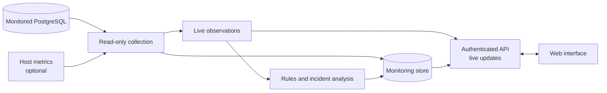
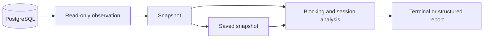

# Architecture overview

LockLens observes PostgreSQL, turns collected data into findings, and preserves the evidence needed to investigate incidents. Its monitoring service, web interface, and monitoring store work together without sitting in your application’s database traffic path.

## Server overview

| Component | Responsibility |
| --- | --- |
| Monitored PostgreSQL | Provides activity, query statistics, replication status, and database metadata. |
| Collection service | Reads each target on a schedule, calculates changes between observations, and records collection gaps. |
| Live observations | Keeps recent values available for live pages and rule evaluation. |
| Rules and incident analysis | Detects findings, follows incidents through their lifecycle, and preserves supporting evidence. |
| Monitoring store | Retains collected history, findings, incidents, and application settings in PostgreSQL, with optional TimescaleDB support. |
| Web interface and API | Present live and historical data through authenticated access. Live events tell the interface when to refresh. |

### Request and data flow

1. **Connect a target.** LockLens validates the connection and stores its credentials encrypted.
2. **Collect observations.** Each target has its own collection schedule. Activity, workload, replication, tables, and host metrics are gathered independently of application requests.
3. **Update live views.** New observations update recent history. Cumulative counters are converted into rates or deltas where applicable.
4. **Save history.** Collected data is written in batches. If the bounded write queue fills, the oldest batch is dropped and the loss is recorded as a collection gap.
5. **Evaluate findings.** Rules examine recent observations. The incident recorder opens, updates, or resolves incidents and saves their evidence.
6. **Refresh the interface.** The API serves live values and stored history. Events notify the interface about new observations, target status changes, and incident updates.
7. **Apply retention.** Scheduled cleanup removes expired history according to the configured retention policy.

Read more about [rules and findings](rules.md), [incident investigation](incidents.md), and [deployment](deployment.md).

### Concurrency and isolation

A slow or unavailable target does not stop collection from other targets. Collectors for a single target run sequentially, while a shared concurrency limit bounds work across targets. Frequent session sampling has a separate limit.

Collection runs have timeouts, connection pools are small, and the write queue is bounded. Incident updates are ordered per target; different targets can be analyzed concurrently.

### Startup and shutdown

At startup, LockLens validates configuration, connects to the monitoring store, prepares its schema, and starts collection and scheduled jobs. When a target is picked up, its open incidents are resumed. Readiness depends on the monitoring store being available.

On shutdown, LockLens stops accepting new requests, finishes in-flight work, stops collectors, and allows queued writes to drain within the shutdown timeout. Batches still queued after the drain period are lost.

## Several databases per instance

Choose which databases to include for tables, indexes, catalogs, and optimizer recommendations:

| Scope | What is observed |
| --- | --- |
| Connection database | Only the database named in the connection settings. This is the default. |
| All accessible databases | Databases the monitoring role can connect to, up to 20. |
| Selected databases | An explicit list of databases. |

Instance-wide observations, including sessions, statements, replication, and settings, are read once through the main connection. Tables, indexes, and recommendations remain associated with their database. What-if checks run only in the connection database.

See [Production topology](production-topology.md) for deployment examples.

## Change timeline

LockLens tracks changes to settings, server state, and schema so they can be compared with performance changes. Settings and server facts are checked every minute; schema observations are compared every 15 minutes.

People and deployment pipelines can also report deployments and migrations. The timeline shows these events alongside instance charts. They provide leads for investigation, not proof that a change caused an incident.

Settings that may contain secrets are compared using fingerprints rather than retaining their values in the change history.

## Several servers

Multiple LockLens servers can share one monitoring store for availability and scale. Targets are assigned through renewable leases. If a server stops or loses its lease, another can take over its targets, typically within about a minute.

### Work distribution

Targets are distributed according to measured collection cost and available capacity. Rebalancing is gradual to avoid moving targets back and forth unnecessarily. Scheduled jobs run once per cluster.

A deployment can combine all responsibilities on each server or separate them:

| Role | Responsibility |
| --- | --- |
| Collector | Observes assigned targets, records incidents, and writes collected data. |
| API | Serves requests and metrics using shared live views and stored history. |
| Jobs | Runs scheduled work such as retention, rollups, and notifications. |

All roles are enabled by default. See [High availability](high-availability.md) for configuration and operational guidance.

### Continuity during takeover

Lease checks prevent a previous owner from updating a target’s incidents, findings, status, or shared live view after ownership changes. A brief overlap in collection can still produce duplicate metric samples.

Incident changes and pending notifications are saved together, allowing notification delivery to continue after a sender stops. Servers share live updates so the interface can connect to a different server from the one collecting a target.

Shared live views refresh about every five seconds. After a monitoring-store crash or failover, these views can be temporarily unavailable until the next refresh. Detailed recent samples remain local to the collecting server.

## Log agent

The optional log agent runs on the database host and reads PostgreSQL logs without connecting to the database. It recognizes slow statements, query plans, lock waits, deadlocks, maintenance activity, checkpoints, and errors.

Before sending events, the agent normalizes statement text and redacts sensitive details. It uses an instance-scoped ingest token. If LockLens is unavailable, events are buffered on disk for later delivery.

## Command-line workflow

The command-line interface supports connection checks, live inspection, repeated observation, and saved snapshots. It can inspect a PostgreSQL server without running the monitoring service.

Live inspection and saved snapshots use the same analysis, so the same observations produce consistent results in live and offline investigations.

See the [CLI reference](cli-reference.md) for commands and options.

## Major design decisions

| Principle | What it means in practice |
| --- | --- |
| Read-only monitoring | Collection uses read-only transactions and does not cancel sessions, terminate connections, or modify monitored data. |
| PostgreSQL defines blocking relationships | Blocking graphs use PostgreSQL’s reported blockers rather than guessing conflicts from lock rows. |
| Raw evidence is preserved | Snapshots retain observations so analysis can be reproduced and revisited later. |
| Missing data remains visible | Unavailable measurements appear as gaps or insufficient data, rather than being presented as zero. |
| Live views and retained history serve different needs | Recent observations support live pages; the monitoring store supports historical charts and investigation. |
| Findings explain their evidence | Rules use configurable thresholds and report limitations. Possible explanations are not presented as confirmed causes. |
| Incidents retain their own evidence | Incident records remain useful after the underlying raw history expires. |
| Monitoring avoids observing itself | LockLens excludes its own database connections from activity analysis. |
| Collection work is bounded | Client and database timeouts limit how long an observation can run. |
| Credentials stay private | Connection credentials are encrypted at rest and are not returned in API responses or diagnostic output. |

See [PostgreSQL observation and permissions](postgresql-observation.md) and the [Security model](security.md) for details.

## On-demand investigation boundary

The investigation workspace is separate from background monitoring. It opens a restricted connection for an explicit request, runs bounded read-only operations, records safe audit metadata, and closes the connection afterward.

There is no background table reader or stored history of workspace results. Connection credentials remain isolated from the browser, and SQL and result values are displayed as text.

See [Explorer and SQL](investigation-workspace.md) for execution limits, access policies, and operational limitations.
